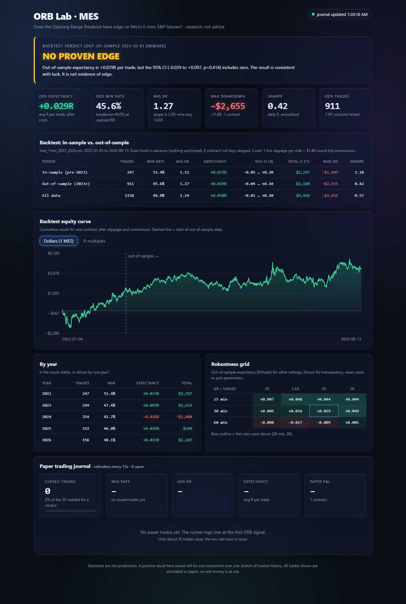

# ORB Lab: does the Opening Range Breakout have edge on MES futures?

A research system that tests one question honestly before any real money is involved: **does a
simple Opening Range Breakout (ORB) strategy make money on Micro E-mini S&P 500 (MES) futures
after costs, on data it was not designed on?**

It is a high school quant research project. The goal is to learn how to test a trading idea
properly (fixed rules, out-of-sample validation, real costs, statistical honesty) and to build a
paper-trading track record. It is not trading advice and it does not trade real money.



## Result so far: no proven edge

| Period | Trades | Win rate | Avg RR | Expectancy | 95% CI (R/trade) | Max drawdown | Sharpe |
|---|---:|---:|---:|---:|---|---:|---:|
| In-sample (2022) | 247 | 51.4% | 1.11 | +0.073R | -0.05 to +0.20 | -$1,903 | 1.10 |
| **Out-of-sample (2023 to Aug 2026)** | **911** | **45.6%** | **1.27** | **+0.029R** | **-0.04 to +0.10** | **-$2,655** | **0.42** |

(1 MES contract, after 1 tick of slippage per side and $1.40 round-trip commission.)

The out-of-sample average is slightly positive, but the confidence interval comfortably includes
zero (p = 0.41), so the honest reading is that **the result is consistent with luck**. The
dashboard labels it `NO PROVEN EDGE` and will say `NO EDGE` if the out-of-sample expectancy turns
negative. Other things the numbers show:

- **It is not stable.** 2024 lost money (-0.028R per trade) while 2022 and 2023 did best.
- **The 2:1 target rarely matters.** Only 140 of 1,158 trades reached the 2R target; 591 were
  still open at the 15:55 ET exit and 427 hit the stop. Most of the result comes from where the
  market happened to close, not from the reward-to-risk setup.
- **Other settings do no better.** A robustness grid (15/30/60-minute ranges x 1R to 3R targets)
  ranges from -0.017R to +0.049R out of sample. A 60-minute range is slightly negative at three of four targets.
  The grid is shown for transparency and is never used to choose parameters.
- **Costs matter.** Edges this small are the kind that disappear with worse fills.

A real edge would need a confidence interval that clears zero, agreement between in-sample and
out-of-sample, and the same story under nearby parameters. None of those is met yet.

## How it works

**Strategy rules** (US/Eastern, fixed before looking at results, never optimized):

1. Opening range = high and low of the 1-minute bars from 09:30 to 10:00.
2. After 10:00, build 5-minute bars. The first 5-minute bar that **closes** above the range high
   (long) or below the range low (short) is the signal.
3. Enter at the **open of the next 1-minute bar** after the signal bar completes, plus slippage.
   (Entering at the signal bar's close would use a price you could not have traded.)
4. Stop = the opposite side of the range. Target = 2x the risk from entry (2:1 reward to risk).
5. One trade per day. If neither level is hit, exit at the last bar at or before 15:55 ET.
6. If one 1-minute bar touches both stop and target, the **stop is assumed to hit first**.

**Validation:** pre-2023 is in-sample, 2023 onward is out-of-sample. Because nothing is fitted,
the split guards against fooling ourselves with a lucky window rather than against curve-fitting.
Every number also has a bootstrap 95% confidence interval and a p-value on mean R per trade.
Contract-roll days are skipped; the data uses a continuous contract (`MES.c.0`).

**One rulebook:** `orblab/strategy.py` is the only place the rules live. The backtester and the
live paper runner both call `evaluate_day`, so a paper trade is decided by the same code that
produced the backtest. Ten unit tests check the rules (range window, entry price, stop/target
arithmetic, tie-breaking, live behaviour).

## Components

| Piece | Command | What it does |
|---|---|---|
| ORB backtester | `python -m orblab.backtest` | Runs every session in `data/`, writes `results/backtest.json` and `backtest_trades.csv` |
| Trade journal | `python -m orblab.journal list` | SQLite log of every paper or manual trade: date, direction, entry, stop, target, exit, result, setup (ORB, manual, ...), notes |
| Paper trade runner | `python -m orblab.runner` | Waits for the 09:30 ET open, finds the ORB setup, logs the trade, and updates it to WIN/LOSS at stop, target, or 15:55 ET |
| Stats dashboard | `python -m orblab.dashboard` | http://localhost:8767: verdict, backtest tables, equity curve, journal with live win rate and average RR |

Log a manual trade and close it later:

```bash
python -m orblab.journal add --date 2026-11-02 --dir long --entry 6850.25 --stop 6841 --target 6868.75 --setup manual --notes "faded the open drive"
python -m orblab.journal close 12 --exit 6868.75
```

Re-run a past day through the runner (to test it without waiting for the market):

```bash
python -m orblab.runner --replay 2025-03-14 --db replay.db
```

### Running the paper runner daily

`python -m orblab.runner` pulls delayed 1-minute bars from Yahoo Finance (`MES=F`, or
`--symbol SPY` as a proxy), so it needs no paid data feed. Start it any time before 09:30 ET on a
trading day. On Windows, `schedule_runner.ps1` registers a weekday Task Scheduler job (default
08:20 local, i.e. US Central; pass `-LocalTime` for other zones). Run it yourself, since it
changes system settings.

Limits of the free data: bars are delayed roughly 10 to 15 minutes and may have gaps, so paper
fills are friendlier than real ones. The journal's win rate is noise until about 30 trades have
closed; the dashboard shows progress toward that.

## Setup

```bash
pip install -r requirements.txt
python -m orblab.backtest
python -m orblab.dashboard
python -m unittest discover -s tests
```

The backtest reads 1-minute MES bars from `data/mes_1min_2022_2026.csv` (Databento
`GLBX.MDP3`, `ohlcv-1m`, fetched with `download_mes_history.py`). The data is not committed:
it is large and licensed. Keep API keys in `.env`, which is git-ignored.

## Tech stack

Python, pandas, NumPy, SQLite, `yfinance` (live paper data), the standard-library HTTP server
with a hand-written HTML/SVG dashboard (no frameworks), and `unittest`.

## Honest limitations

- One instrument over about 4.6 years of mostly rising markets (the index went from about
  4,770 to 7,830). A strategy can look fine in one regime and fail in the next.
- Costs are an estimate. Slippage is applied on both entry and exit (conservative for limit-order
  targets); real slippage varies with volatility and time of day.
- A continuous front-month contract is spliced from different expiries.
- 1,158 trades sounds like a lot, but with this much noise per trade it is only enough to
  rule out large edges, not small ones.
- This is a stricter, fixed-rule rebuild of an earlier, more general futures backtester (separate
  project, mid-range stop and extra filters), so results are not comparable with that one.

## Project layout

```
orblab/
  strategy.py   the ORB rules (single source of truth)
  backtest.py   in-sample / out-of-sample run, robustness grid
  stats.py      metrics, bootstrap CI, verdict logic
  journal.py    SQLite journal + CLI
  runner.py     live paper runner and replay mode
  dashboard.py  localhost:8767 server (+ dashboard.html)
tests/          unit tests for the rules
docs/screenshots/
results/        backtest.json, backtest_trades.csv
```

## License and disclaimer

For education and research only. Nothing here is investment advice, and past or simulated
results do not predict future performance. Futures trading carries substantial risk of loss.
